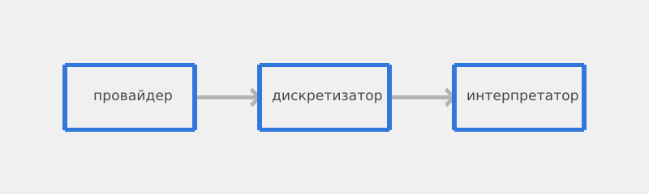
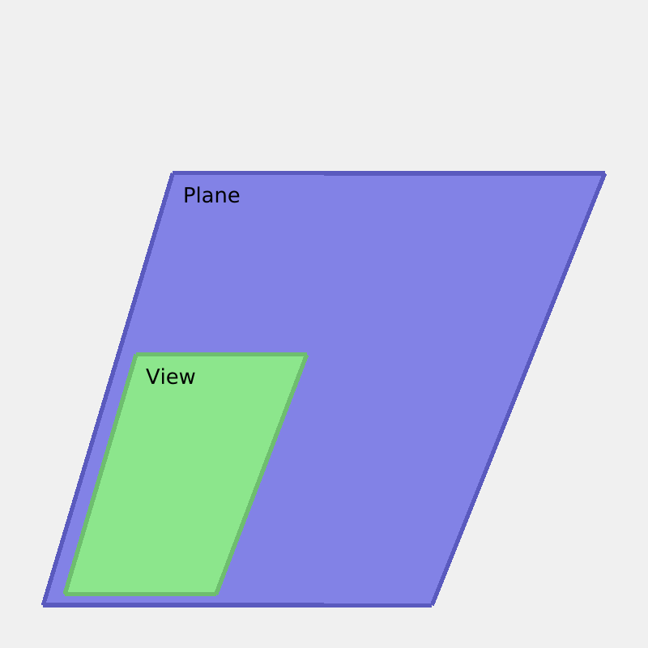
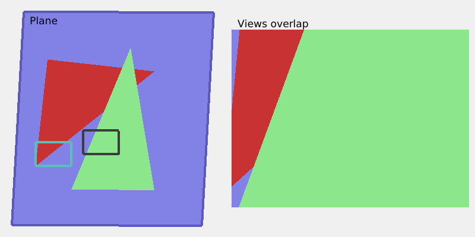

# Overwhelement
---
## Кратко

Overwhelement — преобразователь двумерных плоскостей в дискретные информативные структуры данных. Он принимает набор плоскостей с треугольниками, вершины которых заданы в координатах плоскости, и возвращает буфер элементов, из которого внешняя программа может извлечь всё, что угодно: фреймбуфер, карту высот, карту освещения, иерархию слоёв. Один и тот же буфер интерпретируется произвольным образом: вывод в графическое окно, ASCII-арт, LED-панель, tensor для ML. Код полностью сгенерирован, человеческий интеллект в его создании задействован не был.

---

## Примеры

Директория `examples` содержит примеры использования overwhelement. По адресу
`examples/assets` хранятся ресурсы, которые используются в некоторых примерах. В папке `examples/image_viewers` представлены просмотрщики изображений, сделанные на базе overwhelement. В директории `examples/readme_images` содержится код, который использовался для создания всех изображений в этом же README документе.

---

## Дискретизатор?

Любое непрерывное пространство является бесконечно делимым. У него нет какого-то постоянного "шага": чтобы измерить пространство, нужно взять срез, и назвать это единицей меры. Такой процесс получения среза чего-то бесконечного называют дискретизацией, а единицу меры — дискретом.

Процесс дискретизации в компьютерной графике часто ассоциируется с растеризацией, то есть получением массива векторов, где каждый вектор содержит три целочисленных значения — получением пикселей. Растеризация включает в себя дискретизацию, но это не совсем одинаковые понятия. Один пиксель — это только частный случай дискреты плоскости. Он не содержит в себе всех значений плоскости, из которой его получили. Плоскости могут иметь индексы высот, умножать цвет объекта на его освещённость или опускать другие метаданные, которые не сохраняются в пиксельной структуре. Если нужно не просто раскрасить экран, а получить более полную информацию, приходится запускать процесс растеризации по несколько раз.

Дискретизатором я называю то, что превращает бесконечную плоскость в массив
конечных дискрет с максимальным сохранением информации о плоскости за один
проход. Именно таким дискретизатором и является Overwhelement.

---

## Визуализация

Растеризаторы, как упоминалось ранее, зачастую предоставляют лишь одну
интерпретацию дискреты — пиксель. Я решил, что если я хочу сохранить дискрету в полном виде, то интерпретация этой дискреты останется на внешней программе. Можно извлечь пиксель, если взять дискрету, извлечь оттуда атрибуты и интерполировать их. Можно построить карту высот, если взять ту же дискрету и извлечь оттуда только её глубину.

В связи с этим, я решил отделить "дискретизацию" от "интерпретации", которые
объединены в растеризаторах. Это делает Overwhelement немного более сложным,
но, тем не менее, более гибким в использовании. Один и тот же результат
дискретизации можно интерпретировать несколькими способами. От этого процесс
работы с Overwhelement состоит из трёх этапов:


> Диаграмма сделана с использованием Overwhelement, её код представлен
> в [`examples/readme_images/pipeline_diagram.rs`](examples/readme_images/pipeline_diagram.rs)

1. Одна функция или программа предоставляет двумерную плоскость. Это
   программа-провайдер. Ей может быть программа для проекции трёхмерной сцены, интерфейс приложения, векторное изображение, или ещё что-нибудь, что требует дискретизации.
2. Эта двумерная плоскость отправляется в программу-дискретизатор, и превращается в дискретную структуру данных.
3. Полученная дискретная структура интерпретируется внешней программой-интерпретатором произвольным образом. Неважно как: отображение цвета, рисование изображения, выявление глубины или машинное обучение — что угодно.

---

## Буфер элементов

Результат дискретизации — `ElementBuffer`. Это четырёхмерная структура:
`width × height × layers × capacity`.

- `width`, `height` — размеры выходного буфера.
- `layers` — количество слоёв дискретизации.
- `capacity` — максимальное число элементов в одной клетке `(x, y, layer)`.

Клетка `(x, y, layer)` содержит **стек** элементов, отсортированных по глубине
от ближнего к дальнему. Если элементов больше, чем `capacity`, самый дальний
вытесняется.

**Никто никого не перезаписывает.** Дискретизатор не решает, какой элемент
"победил". Он только складывает элементы в стек, поддерживая порядок по глубине.
Что с этим стеком делать — смешивать, брать ближайший, строить карту глубин,
подавать в нейросеть — решает интерпретатор.

Каждый элемент содержит:

- `object_id` — идентификатор объекта, попавшего в дискрету.
- `depth` — удалённость от наблюдателя.
- `attr` — пользовательские атрибуты, интерполированные по поверхности
  треугольника.

Цвета, прозрачности, освещения в `Element` нет. Это принципиально: дискретизатор
сохраняет **геометрические и объектные** данные, а всё, что касается внешнего
вида, живёт в интерпретаторе.

---

## Атрибуты

Атрибуты — это данные, привязанные к вершине и интерполируемые по поверхности
треугольника. Примеры: UV-координаты для текстуры, нормаль для освещения,
цвет вершины для градиента, что угодно ещё.

Атрибуты описываются пользовательским типом, реализующим трейт `Attributes`:

```rust
pub trait Attributes: Copy {
    fn placeholder() -> Self;
    fn bary(a: &Self, b: &Self, c: &Self, w: [f32; 3]) -> Self;
}
```

`bary` — барицентрическая интерполяция: на вход три атрибута в вершинах
треугольника и три веса, сумма которых равна единице. Что именно считать внутри —
дело реализации. Для UV это линейная интерполяция, для нормали — она же
с последующей нормализацией, для чего угодно ещё — что угодно.

Тип атрибутов — параметр `Scene<A>` и `ElementBuffer<A>`. Если атрибуты не
нужны, используется `A = ()` и за это ничего не платится.

Атрибуты заменили собой шейдеры. Старый вариант с `ShaderPool` и `Rc` был
динамическим: шейдер выбирался в рантайме через указатель, что давало
непредсказуемую производительность. Теперь способ интерполяции известен
на этапе компиляции, мономорфизируется и инлайнится.

---

## Плоскости, виды, порты, слои

Плоскость (`Plane`) — контейнер треугольников. Она описывает кусок геометрии
в произвольных координатах: пиксели изображения, миллиметры чертежа, что угодно.


> Рисунок сделан с использованием Overwhelement, его код представлен
> в [`examples/readme_images/plane_view.rs`](examples/readme_images/plane_view.rs)

Вид (`View`) — прямоугольная область на плоскости. Он говорит: "возьми вот этоткусок плоскости". Вид можно двигать, масштабировать, поворачивать, 
по горизонтали и вертикали.

Порт (`Port`) — прямоугольная область в выходном буфере, плюс правила масштабирования. Он говорит: "положи то, что взял вид, вот сюда и вот так". Порт задаёт `ScalingMode`, соотношение сторон дискреты и смещение внутри буфера.

Слой (`Layer`) связывает одну плоскость с набором пар `(View, Port)`. Каждая пара — один проход дискретизации: геометрия плоскости, взятая через вид, выводится через порт. Один слой может содержать несколько пар, если с одной
плоскости нужно сделать несколько снимков.

Порядок слоёв в `Configuration::layers` задаёт порядок обработки и, соответственно, координату `layer` в буфере.

---

## Перекрытия

Перекрытия в Overwhelement работают на двух уровнях.


**Внутри одной плоскости.** Если один и тот же участок плоскости виден через
несколько видов, элементы из разных видов попадают в один и тот же стек буфера. Их взаимный порядок определяется глубиной: элемент с меньшей глубиной оказывается ближе к началу стека. Виды не перезаписывают друг друга — они **дополняют** друг друга информацией.


> Рисунок сделан с использованием Overwhelement, его код представлен
> в [`examples/readme_images/multiple_views.rs`](examples/readme_images/multiple_views.rs)

**Между слоями.** Слои независимы. Элементы из разных слоёв лежат в разных
клетках буфера по третьей оси и не взаимодействуют. Интерпретатор сам решает, как их комбинировать: взять верхний слой, смешать несколько, обойти все по порядку. Глубина внутри одного слоя на это не влияет.

Такое разделение даёт максимальную гибкость: одна и та же сцена, разложенная
по слоям, может быть собрана в плоское изображение, в иерархию, в карту
глубин, в tensor — без повторной дискретизации.

---

*TODO: Дописать README*
